<!--
PLANTILLA DE MÓDULO
Copia este archivo a docs/business/NN-nombre-del-modulo.md y reemplaza todo lo que esté entre < >.
Los comentarios <!-- --> son guía: bórralos en el documento final.
Las secciones marcadas (opcional) se eliminan completas si no aplican. No dejes secciones vacías.
-->

# <Nombre del módulo>

> Prefijo de IDs: `<XXX>` · Estado: <vigente | en desarrollo>

## Resumen

<!-- 2-3 líneas máximo: qué es, para qué sirve y qué NO cubre (con enlace al doc que sí lo cubre). -->

<Qué es y para qué sirve.>
No cubre <tema>: ver [<doc>](<ruta>.md).

## Actores

<!-- Solo quienes intervienen en ESTE módulo. Los roles completos viven en 02-roles-and-permissions.md. -->

| Actor | Qué hace aquí |
|-------|---------------|
| <actor> | <acción> |

## Conceptos clave (opcional)

<!-- Solo términos propios de este módulo que no estén en 01-glossary.md. Si es transversal, va al glosario. -->

| Término | Significado |
|---------|-------------|
| <término> | <definición en una línea> |

## Reglas de negocio

<!--
Una regla = una condición verificable. Sin explicaciones largas: el "por qué" va en una línea aparte solo si no es obvio.
Cada regla lleva ID estable (<XXX>-R1, R2…). Nunca reutilices ni renumeres un ID existente; si una regla se elimina, deja el hueco.
-->

| ID | Regla |
|----|-------|
| <XXX>-R1 | <Condición verificable.> |
| <XXX>-R2 | <Condición verificable.> |

## Ciclo de vida (opcional)

```mermaid
stateDiagram-v2
  [*] --> <estado_a>
  <estado_a> --> <estado_b>: <condición>
```

<!-- Solo si la entidad tiene estados. Diagrama de estados + una línea por transición con su condición. -->

## Flujos

<!--
Un flujo = una secuencia con inicio y fin. Elige el formato más corto que lo explique:
- Pasos numerados si es lineal.
- Mermaid flowchart si hay decisiones.
- Mermaid sequence si intervienen varios actores/sistemas.
No narres lo que el diagrama ya dice.
-->

### <Nombre del flujo principal>

1. <Paso.>
2. <Paso.>

### Flujos alternos (opcional)

<!-- Solo si hay caminos con peso propio (rechazo, expiración, reintento). Si no, van como escenarios. -->

## Escenarios

<!--
"¿Qué pasa si…?". Un escenario = un único resultado esperado (nada de "403 / validación").
Cada fila debe poder convertirse en un test. Referencia la regla que lo origina.
Situación = precondiciones concretas (estado, datos, permisos). Resultado = efecto observable
(HTTP, estado, fila creada/no). Evitar solo "OK" / "Error" / "Rechazado".
-->

| ID | Actor | Situación | Resultado esperado | Regla |
|----|-------|-----------|--------------------|-------|
| <XXX>-01 | <actor> | <precondiciones concretas> | <efecto observable único> | <XXX>-R1 |

## Referencias

<!-- Solo enlaces y rutas, sin texto explicativo. -->

- Código: `<ruta/archivo>`
- Tablas: `<tabla>` ([database-schema](../technical/database-schema.md))
- Permisos: `<permiso.accion>`
- Relacionados: [<doc>](<ruta>.md)
