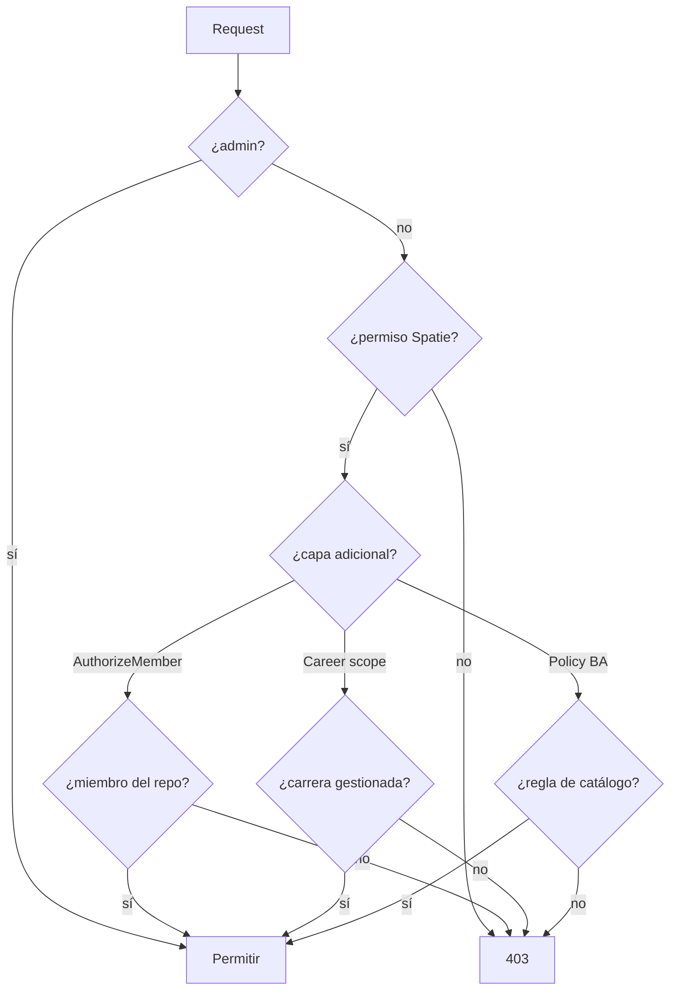

# Roles, permisos y autorización

Fuente: `app/Support/Permissions.php`, `app/Support/UserRoles.php`, policies, middleware.

## Roles de sistema

| Rol | Guard | Notas |
|-----|-------|-------|
| `admin` | web | Sin permisos sembrados; `Gate::before` concede **todo** |
| `director` | web | Alcance institucional amplio |
| `career_director` | web | Alcance por carrera(s) gestionada(s) |
| `teacher` | web | Docente / posible asesor académico |
| `student` | web | Alumno |

Compatibilidad rol ↔ `user_type`:

| Rol | `user_type` permitido |
|-----|------------------------|
| `student` | `academic` |
| `teacher`, `career_director` | `workforce` |
| `admin`, `director` | `staff` |

## Capas de autorización

1. **Spatie** (`can('…')`) — qué acción.
2. **Middleware** `AuthorizeMember` — admin o miembro del repositorio.
3. **Career scope** — alta/edición de usuarios limitada a carreras del director (`EnsureCanManageUser` / `managedCareerIds`).
4. **Policies de catálogo BA** — verify/contact/attach con reglas de filas (`CatalogAuthorization`).

## Matriz de permisos por defecto

`Permissions::defaultsForRole`. Admin = bypass.

| Área | director | career_director | teacher | student |
|------|:--------:|:---------------:|:-------:|:-------:|
| users.index/create/edit | ✓ | ✓ | — | — |
| users.destroy | ✓ | — | — | — |
| users.toggle-active / update-role / password-link | ✓ | ✓ | — | — |
| users.search | ✓ | ✓ | ✓ | ✓ |
| users.career.any | ✓ | — | — | — |
| users.assign.* | CD,T,S | T,S | — | — |
| roles / careers / project_types / education_levels CRUD | —* | —* | — | — |
| repositories.index/create/edit | ✓ | ✓ | ✓ | ✓ |
| repositories.destroy | ✓ | ✓ | ✓ | — |
| files.* | ✓ | ✓ | ✓ | ✓ |
| project_periods CRUD | ✓ | index | — | — |
| advisors.capacity.manage / override_capacity | ✓ | — | — | — |
| advisors.assign / distribute | ✓ | ✓ | — | — |
| business_advisors.search/create/attach/view_contact | ✓ | ✓ | ✓ | ✓ |
| business_advisors.verify | ✓ | ✓ | ✓ | — |
| business_advisors.merge | ✓ | ✓ | — | — |
| business_advisors.manage / view_audit / privacy_requests | ✓ | — | — | — |
| companies.create | ✓ | ✓ | ✓ | ✓ |
| companies.verify | ✓ | ✓ | ✓ | — |
| companies.merge | ✓ | ✓ | — | — |

\* Definidos en catálogo de permisos pero **no** en defaults de rol → en la práctica solo admin (Gate).

`business_advisors.export` existe pero no está en defaults de ningún rol (solo admin vía Gate).

## Quién puede asignar qué rol

| Actor | Puede asignar |
|-------|----------------|
| director | career_director, teacher, student |
| career_director | teacher, student |
| teacher / student | ninguno (defaults) |

Requiere permiso dinámico `users.assign.{role}` (`RoleAssignPermissionSync`).

## Escenarios de autorización

| ID | Actor | Situación | Resultado esperado | Regla |
|----|-------|-----------|--------------------|-------|
| AUTH-01 | Visitante (sin sesión) | Solicita la URL de show de un repositorio con `is_public = false` | Respuesta **404**; no se revela que el repo existe | AUTH-R1 |
| AUTH-02 | Docente autenticado, con `repositories.edit`, pero **no** figura en `repository_user` | Intenta abrir el panel de gestión / update del repo | Respuesta **403** por `AuthorizeMember` | AUTH-R2 |
| AUTH-03 | `career_director` de TIC, sin permiso `users.career.any` | Intenta editar un alumno cuya carrera es ER | Respuesta **403**; no se aplica el cambio | AUTH-R3 |
| AUTH-04 | Docente con `business_advisors.verify` | Intenta verificar un `business_advisor` en `pending_review` que él mismo creó | Verificación rechazada (policy / validación); el registro sigue `pending_review` | AUTH-R4 |
| AUTH-05 | Alumno con `business_advisors.search` | Busca un asesor ya `verified` (query ≥ 3 caracteres) | Aparece en resultados con correo enmascarado; sin teléfono ni correo completo | AUTH-R5 |
| AUTH-06 | Alumno A | Busca un asesor `pending_review` creado por el alumno B | El pendiente de B **no** aparece en los resultados de A | AUTH-R5 |
| AUTH-07 | Admin | Cualquier acción gateada (roles, catálogos, repos ajenos) | Permitido por `Gate::before` sin necesitar el permiso Spatie sembrado | AUTH-R6 |

### Reglas referenciadas

| ID | Regla |
|----|-------|
| AUTH-R1 | Guest / no autorizado ante repo privado recibe **404** (ocultar existencia). |
| AUTH-R2 | Gestión de repo exige admin o membresía (`AuthorizeMember`). |
| AUTH-R3 | Sin `users.career.any`, el gestor solo opera usuarios de carreras que dirige. |
| AUTH-R4 | Nadie verifica un registro de catálogo BA que él mismo creó. |
| AUTH-R5 | Búsqueda BA: solo validados + pendientes propios; contacto enmascarado en lista. |
| AUTH-R6 | Rol `admin`: `Gate::before` concede todas las abilities. |

## Referencias

- Código: `app/Support/Permissions.php`, `app/Support/UserRoles.php`
- Relacionados: [03-users-and-profiles.md](03-users-and-profiles.md), [08-business-advisors-and-companies.md](08-business-advisors-and-companies.md)
