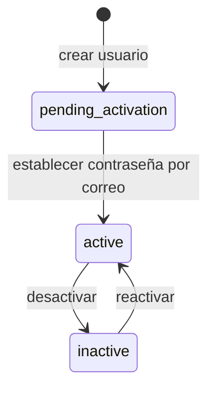
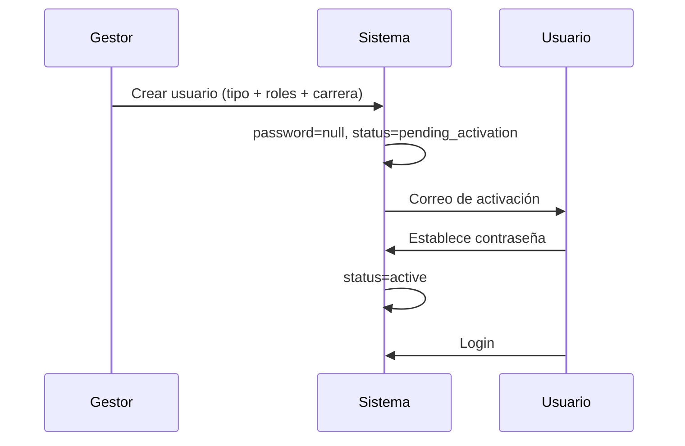

# Usuarios, perfiles y activación

> Prefijo de IDs: `USR` · Estado: vigente

## Resumen

Alta, activación y perfiles de usuarios (`academic` / `workforce` / `staff`), más asignaciones de carrera.
No cubre matriz de permisos Spatie: ver [02-roles-and-permissions.md](02-roles-and-permissions.md).
No cubre elegibilidad como asesor académico: ver [07-academic-advisors.md](07-academic-advisors.md).

## Actores

| Actor | Qué hace aquí |
|-------|---------------|
| Administrador / director | Alta, edición, desactivación, enlace de contraseña; alcance amplio |
| Director de carrera | Alta/edición de usuarios de sus carreras; asigna teacher/student |
| Usuario nuevo | Activa cuenta estableciendo contraseña |

## Conceptos clave

| Término | Significado |
|---------|-------------|
| Perfil tipado | Un usuario tiene exactamente un perfil: `student_profiles`, `teacher_profiles` o `staff_profiles` |
| Asignación de carrera | Fila en `career_assignments` con `position` y vigencia (`ends_at`) |

## Reglas de negocio

| ID | Regla |
|----|-------|
| USR-R1 | Los roles asignados deben ser compatibles con `user_type` (ver [02](02-roles-and-permissions.md)). |
| USR-R2 | Carrera(s) obligatorias para `student`, `teacher` y `career_director`. |
| USR-R3 | Sin `users.career.any`, el gestor solo opera usuarios de carreras que dirige. |
| USR-R4 | Alta deja `password = null` y `status = pending_activation`; tras fijar contraseña pasa a `active`. |
| USR-R5 | Solo se puede alternar `active` ↔ `inactive` (no desde `pending_activation`). |
| USR-R6 | Middleware `EnsureUserIsActive` bloquea login/sesión de pendientes e inactivos. |
| USR-R7 | Asignación de carrera activa si `ends_at` es null o futuro. |
| USR-R8 | Un solo `career_director` activo por carrera. |
| USR-R9 | Asignar director de carrera sincroniza el rol Spatie `career_director`; al cerrar la última asignación se quita el rol. |
| USR-R10 | Docentes: multi-carrera; carreras omitidas en update se cierran (`ends_at`). |
| USR-R11 | Cambio `academic` → no academic marca estudiante `academic_status = graduated`. |
| USR-R12 | `teacher_profiles.can_be_advisor` (default `true`) controla elegibilidad como asesor académico y verificación BA como teacher. |

## Ciclo de vida

## Flujos

### Alta y activación

## Escenarios

| ID | Actor | Situación | Resultado esperado | Regla |
|----|-------|-----------|--------------------|-------|
| USR-01 | Director con `users.create` | Da de alta alumno: `user_type = academic`, rol `student`, carrera TIC activa | Usuario creado con `password = null`, `status = pending_activation`, perfil `student_profiles` y carrera TIC; se dispara correo de activación | USR-R2 |
| USR-02 | Director | Da de alta director de carrera: `workforce` + rol `career_director` + assignment `position = career_director` en TIC (sin otro director activo) | Usuario creado; rol Spatie `career_director` sincronizado; assignment activa en TIC | USR-R9 |
| USR-03 | Director | Intenta crear un segundo `career_director` activo en la misma carrera TIC | Alta/asignación rechazada; sigue un solo director activo | USR-R8 |
| USR-04 | Usuario en `pending_activation` | Intenta iniciar sesión con email correcto antes de fijar contraseña | Login bloqueado; mensaje flash; no obtiene sesión autenticada | USR-R6 |
| USR-05 | Gestor con `users.password-link` | Solicita reenvío del enlace de activación/contraseña para un usuario pendiente | Se reenvía el correo de enlace; el usuario sigue en `pending_activation` hasta usarlo | USR-R4 |
| USR-06 | Gestor | Intenta pasar un usuario de `pending_activation` a `inactive` con el toggle de estado | Operación rechazada; solo se permite alternar `active` ↔ `inactive` | USR-R5 |
| USR-07 | Director | Actualiza docente omitiendo una de sus dos carreras activas (TIC y ER → solo TIC) | La assignment de ER se cierra con `ends_at`; TIC permanece activa | USR-R10 |
| USR-08 | Gestor | Cambia `user_type` de un alumno de `academic` a `workforce` | Perfil estudiante queda con `academic_status = graduated`; se crea perfil workforce según el alta | USR-R11 |

## Referencias

- Código: `app/Services/UserProvisioningService.php`, `app/Support/UserRoles.php`
- Tablas: `users`, `student_profiles`, `teacher_profiles`, `staff_profiles`, `career_assignments` ([database-schema](../technical/database-schema.md))
- Permisos: `users.*`, `users.assign.{role}`, `users.career.any`, `users.password-link`
- Relacionados: [02-roles-and-permissions.md](02-roles-and-permissions.md), [04-catalogs.md](04-catalogs.md)
