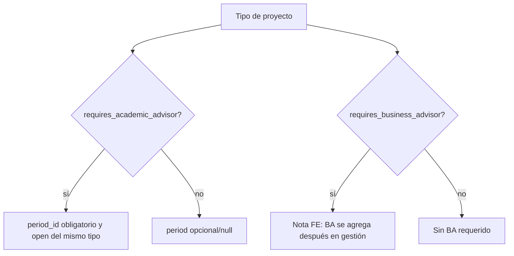

# Repositorios

> Prefijo de IDs: `REP` · Estado: vigente

## Resumen

Proyecto académico con metadatos, miembros, archivos, periodo opcional y organización opcional.
No cubre detalle de periodos/asesores académicos: ver [06-project-periods.md](06-project-periods.md) y [07-academic-advisors.md](07-academic-advisors.md).
No cubre detalle de organización BA: ver [08-business-advisors-and-companies.md](08-business-advisors-and-companies.md).

## Actores

| Actor | Qué hace aquí |
|-------|---------------|
| Alumno / docente / gestor | Crea y edita repositorios (con permiso) |
| Miembro | Gestiona datos, miembros, archivos, organización |
| Visitante | Consulta solo repositorios públicos |
| Admin | Bypass de membresía |

## Reglas de negocio

| ID | Regla |
|----|-------|
| REP-R1 | `visibility = public` → `is_public = true` y aparece en índice público. |
| REP-R2 | Guest / no autorizado ante repo privado recibe **404**. |
| REP-R3 | Show público: solo archivos `is_public`; relacionados = misma carrera, públicos, máx. 6; sin asesor empresarial ni contactos. |
| REP-R4 | Crear exige `repositories.create` y datos base: título, descripción, keywords, generación, códigos activos de carrera/tipo/nivel, `visibility`. |
| REP-R5 | Si el tipo tiene `requires_academic_advisor`, `period_id` obligatorio y periodo `open` del mismo tipo. |
| REP-R6 | `requires_business_advisor` **no** bloquea el create; el BA se adjunta después desde gestión (ver [08](08-business-advisors-and-companies.md)). |
| REP-R7 | `member_emails` al crear: máximo **8**, distintos, solo usuarios con rol `student` existentes; el creador siempre se agrega. |
| REP-R8 | El creador siempre queda como miembro. |
| REP-R9 | Editar exige miembro (o admin) + `repositories.edit`. |
| REP-R10 | No se puede cambiar de periodo si hay asesor académico activo. |
| REP-R11 | Periodo nuevo debe ser del tipo correcto y estar abierto (o mantener el actual). |
| REP-R12 | Sync de organización en **update** solo si el request trae `company` o `business_advisor`; create no sincroniza organización. |
| REP-R13 | Si el update dispara sync de BA, attach usa `send_confirmation = false`. Agregar miembros en settings solo permite alumnos. |

## Flujos

### Condicionales al crear

### Wizard FE (pasos)

1. Información del repositorio
2. Proyecto (tipo, nivel, periodo, carrera, generación)
3. Colaboradores (solo alumnos)
4. Ajustes / visibilidad

Asesores académicos y empresariales: sección en **gestionar repositorio**, no en el create.

## Escenarios

| ID | Actor | Situación | Resultado esperado | Regla |
|----|-------|-----------|--------------------|-------|
| REP-01 | Visitante | Entra al índice público de repositorios | Solo aparecen repos con `is_public = true`; los privados no listan | REP-R1 |
| REP-02 | Visitante | Abre por slug un repo con `is_public = false` | Respuesta **404** | REP-R2 |
| REP-03 | Visitante | Abre un repo público que tiene 3 archivos públicos y 2 privados, más un asesor empresarial adjunto | Ve solo los 3 archivos públicos y metadatos del proyecto; **no** ve asesor empresarial ni contactos; relacionados ≤ 6 de la misma carrera | REP-R3 |
| REP-04 | Alumno | Crea repo tipo `integrative` sin `period_id`, o con periodo `draft`/`closed` | Validación falla: exige periodo `open` del mismo tipo | REP-R5 |
| REP-05 | Alumno | Crea repo tipo `integrative` con periodo `open` correcto, sin BA | Repo creado; creador queda en `repository_user`; **no** se asigna asesor académico ni empresarial automáticamente | REP-R5 |
| REP-06 | Alumno | Crea repo tipo con `requires_business_advisor` sin empresa/asesor | Repo creado OK; BA pendiente de adjuntar en gestión | REP-R6 |
| REP-07 | Docente autenticado con permiso de edición, **no** miembro del repo | Envía update del repositorio | **403** | REP-R9 |
| REP-08 | Creador | En el wizard envía 9 emails distintos en `member_emails` | Validación falla (`max:8`); no se crea el repo | REP-R7 |
| REP-09 | Miembro | Intenta cambiar `project_period_id` mientras hay un `repository_advisors` primary activo (`released_at` null) | Cambio de periodo rechazado | REP-R10 |
| REP-10 | Miembro | Update de visibilidad **sin** claves `company`/`business_advisor` | Solo cambia visibilidad; no toca BA ni empresa | REP-R12 |
| REP-11 | Miembro | Intenta agregar un docente como colaborador en settings | Validación falla: solo alumnos | REP-R13 |

## Referencias

- Código: `app/Http/Controllers/RepositoryController.php`, `StoreRepositoryRequest`, `UpdateRepositoryRequest`, `RepositoryOrganizationService`
- Tablas: `repositories`, `repository_user` ([database-schema](../technical/database-schema.md))
- Permisos: `repositories.create`, `repositories.edit`, `repositories.destroy`, `repositories.index`
- Relacionados: [04-catalogs.md](04-catalogs.md), [06-project-periods.md](06-project-periods.md), [08-business-advisors-and-companies.md](08-business-advisors-and-companies.md), [09-files-and-media.md](09-files-and-media.md)
