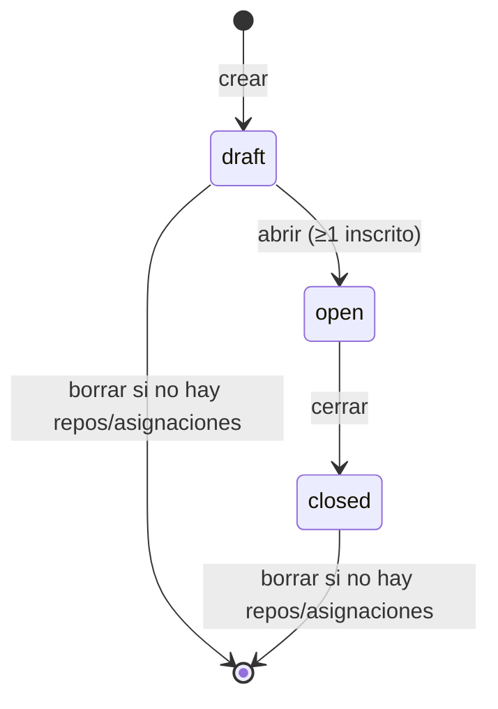

# Periodos de proyecto

> Prefijo de IDs: `PER` · Estado: vigente

## Resumen

Ventanas (`project_periods`) por tipo de proyecto que agrupan inscritos y repositorios para la temporada académica.
No cubre asignación/cupo de asesores académicos: ver [07-academic-advisors.md](07-academic-advisors.md).
Flujo institucional de punta a punta: [flows/academic-advisor-assignment.md](../flows/academic-advisor-assignment.md).

## Actores

| Actor | Qué hace aquí |
|-------|---------------|
| Director | CRUD de periodos, abrir/cerrar, inscribir |
| Director de carrera | Consulta (`index`); asignaciones en [07](07-academic-advisors.md) |
| Alumno | Se asocia a un periodo al crear repo que lo exige; puede figurar como inscrito |

## Conceptos clave

| Término | Significado |
|---------|-------------|
| Demanda (cobertura) | Si `is_team_project`: # repositorios; si no: # alumnos inscritos |

## Reglas de negocio

| ID | Regla |
|----|-------|
| PER-R1 | Solo existen periodos para tipos con `requires_academic_advisor`. |
| PER-R2 | Estados: `draft` → `open` → `closed`. |
| PER-R3 | Abrir exige al menos un alumno inscrito. |
| PER-R4 | No se inscribe en periodo `closed`. |
| PER-R5 | No se borra el periodo si ya hay repositorios o asignaciones. |
| PER-R6 | Inscripción solo de usuarios académicos con carrera en su perfil. |
| PER-R7 | Un alumno no puede estar en dos periodos `open` del mismo tipo de proyecto a la vez. |
| PER-R8 | Crear/actualizar repo con tipo que exige asesor académico requiere `period_id` de periodo `open` del mismo tipo. |

## Ciclo de vida

## Flujos

### Apertura de periodo

1. Gestor crea periodo en `draft` para un tipo con `requires_academic_advisor`.
2. Inscribe al menos un alumno.
3. Abre el periodo (`open`).
4. Alumnos crean repositorios ligados al periodo (sin asignación automática de docente).

## Escenarios

| ID | Actor | Situación | Resultado esperado | Regla |
|----|-------|-----------|--------------------|-------|
| PER-01 | Director | Periodo `draft` de integradora **sin** filas en `project_period_participants`; intenta abrirlo | Apertura rechazada; el periodo sigue en `draft` | PER-R3 |
| PER-02 | Director | Periodo `draft` con ≥1 alumno inscrito; lo abre | Estado pasa a `open`; ya se pueden ligar repos y asignar asesores | PER-R2 |
| PER-03 | Alumno de TIC | Ya está inscrito en integradora `open` A; intenta inscribirse en otra integradora `open` B | Segunda inscripción rechazada | PER-R7 |
| PER-04 | Alumno | Ya inscrito en integradora `open`; se inscribe en estadía `open` (otro `project_type`) | Inscripción a estadía aceptada (el bloqueo es por mismo tipo) | PER-R7 |
| PER-05 | Alumno | Crea repo `integrative` sin elegir periodo, o eligiendo uno `closed` | Validación del repo falla en `period_id` | PER-R8 |
| PER-06 | Director | Periodo `closed` que ya tiene repositorios ligados; intenta borrarlo | Borrado rechazado | PER-R5 |
| PER-07 | Director | Periodo `draft` sin repos ni asignaciones de asesores; lo borra | Periodo eliminado | PER-R5 |
| PER-08 | Gestor | Intenta inscribir a un alumno en un periodo ya `closed` | Inscripción rechazada | PER-R4 |

## Referencias

- Código: `app/Http/Controllers/ProjectPeriodController.php`
- Tablas: `project_periods`, `project_period_participants` ([database-schema](../technical/database-schema.md))
- Permisos: `project_periods.*`
- Relacionados: [04-catalogs.md](04-catalogs.md), [05-repositories.md](05-repositories.md), [07-academic-advisors.md](07-academic-advisors.md)
