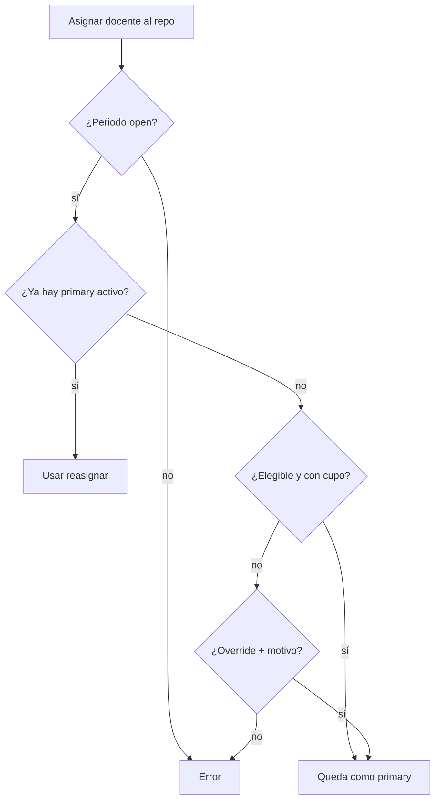

# Asesores académicos

> Prefijo de IDs: `ADV` · Estado: vigente

## Resumen

Asignación de docentes (`users` + `teacher_profiles`) a repositorios dentro de un periodo, con elegibilidad por carrera y cupo de carga.
No cubre ciclo de vida del periodo ni inscripción: ver [06-project-periods.md](06-project-periods.md).
Asesor empresarial (persona externa): ver [08-business-advisors-and-companies.md](08-business-advisors-and-companies.md).

## Actores

| Actor               | Qué hace aquí                                         |
| ------------------- | ----------------------------------------------------- |
| Director            | Gestiona cupos, override, asigna y distribuye         |
| Director de carrera | Asigna/distribuye en carreras que gestiona            |
| Docente             | Es elegible si `can_be_advisor` y cumple carrera/cupo |

## Conceptos clave

| Término        | Significado                                                       |
| -------------- | ----------------------------------------------------------------- |
| Saturación     | Ratio carga/cupo; candidatos se ordenan por menor saturación      |
| Primary activo | Única asignación `role = primary` con `released_at` null por repo |

## Reglas de negocio

| ID      | Regla                                                                                                                                                    |
| ------- | -------------------------------------------------------------------------------------------------------------------------------------------------------- |
| ADV-R1  | Asignar o reasignar asesores solo con periodo en estado `open`.                                                                                          |
| ADV-R2  | Cupo = 0 si `is_available = false`; si no, coalesce(tope del docente en periodo, tope default del periodo, `PROJECTS_DEFAULT_ADVISOR_CAPACITY` = **5**). |
| ADV-R3  | Carga = asignaciones activas (`released_at` null) del asesor en el periodo.                                                                              |
| ADV-R4  | Si carga ≥ cupo, rechazo salvo `advisors.override_capacity` + motivo.                                                                                    |
| ADV-R5  | `can_be_advisor = false` → fuera del pool de elegibles.                                                                                                  |
| ADV-R6  | Elegible solo si alguna carrera del docente cubre la del repo y solapa fechas del periodo.                                                               |
| ADV-R7  | Director de carrera sin “cualquier carrera” solo opera sobre sus carreras.                                                                               |
| ADV-R8  | Un solo asesor `primary` activo por proyecto.                                                                                                            |
| ADV-R9  | Reasignar = liberar actual (`released_at`) y asignar otro.                                                                                               |
| ADV-R10 | El enum `co_advisor` existe; el flujo actual solo crea `primary` (ver [99-known-gaps](99-known-gaps.md)).                                                |
| ADV-R11 | Liberar no borra el registro: pone `released_at` (historia).                                                                                             |
| ADV-R12 | Distribución automática: repos del periodo sin primary; propone por menor carga proyectada; al aplicar no inventa overrides.                             |
| ADV-R13 | Cobertura: demanda = # repos si `is_team_project`, si no # inscritos; sugiere cupo ≈ ceil(demanda / docentes elegibles distintos).                       |

## Flujos

### Asignación manual

### Reparto automático

1. Toma repos del periodo sin primary.
2. Mira demanda por carrera y escasez de cupo.
3. Propone pares docente↔repo priorizando menor carga proyectada.
4. Al aplicar, asigna lo propuesto; lo no asignable queda como fallo.

## Escenarios

| ID | Actor | Situación | Resultado esperado | Regla |
|----|-------|-----------|--------------------|-------|
| ADV-01 | Director | Periodo aún en `draft`; intenta asignar docente a un repo del periodo | Asignación rechazada | ADV-R1 |
| ADV-02 | Director | Repo ya tiene primary activo; intenta un `assign` de otro docente (sin flujo de reasignar) | Error; el primary actual no se toca | ADV-R8 |
| ADV-03 | Director | Docente elegible con carga = cupo (ej. cupo 5, ya 5 activos); sin permiso/motivo de override | Asignación rechazada; no se crea fila activa | ADV-R4 |
| ADV-04 | Director con `advisors.override_capacity` | Mismo docente a tope; envía asignación **con motivo** de override | Se crea asignación primary activa pese a superar cupo | ADV-R4 |
| ADV-05 | Sistema (pool) | Docente solo con career_assignment en ER; repo del periodo es carrera TIC | Docente **no** entra al pool de elegibles | ADV-R6 |
| ADV-06 | Sistema (pool) | Docente con assignments activas en TIC y ER; repo TIC; `can_be_advisor = true`; carga < cupo | Docente aparece elegible; ordenado por menor saturación frente a pares | ADV-R6 |
| ADV-07 | Sistema (pool) | Docente con `teacher_profiles.can_be_advisor = false` | No aparece en el pool aunque tenga carrera y cupo | ADV-R5 |
| ADV-08 | Director | Usa reasignar: primary Ana activa → Bob | Fila de Ana queda con `released_at` set; Bob queda como primary activo | ADV-R9 |
| ADV-09 | Director | Lanza distribución automática sobre 3 repos sin primary; uno no tiene elegibles con cupo | Se asignan los que se puedan; el sin cupo/elegibles queda como fallo **sin** crear override automático | ADV-R12 |
| ADV-10 | Director de carrera (solo TIC) | Intenta asignar asesor a un repo de carrera ER | Operación rechazada por alcance de carrera | ADV-R7 |

## Referencias

- Código: `app/Services/Advisors/*`
- Tablas: `repository_advisors`, `advisor_period_capacities` ([database-schema](../technical/database-schema.md))
- Permisos: `advisors.assign`, `advisors.distribute`, `advisors.capacity.manage`, `advisors.override_capacity`
- Relacionados: [06-project-periods.md](06-project-periods.md), [03-users-and-profiles.md](03-users-and-profiles.md), [flows/academic-advisor-assignment.md](../flows/academic-advisor-assignment.md)

