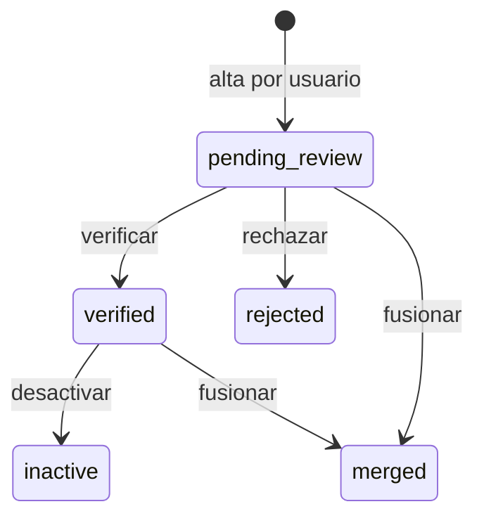
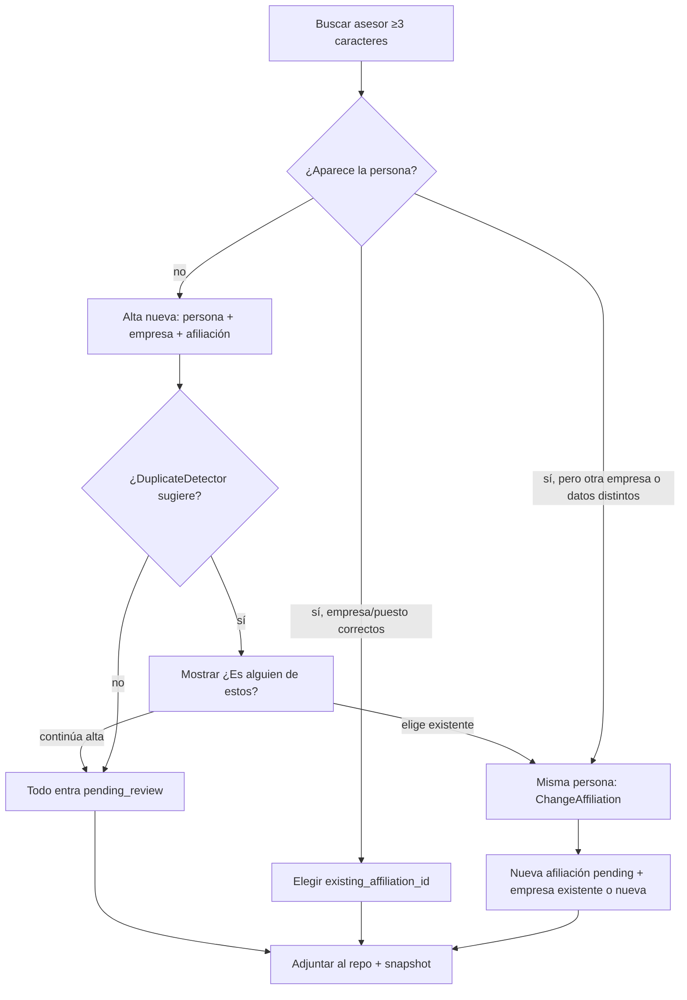
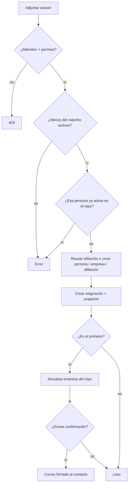

# Empresas y asesores empresariales

> Prefijo de IDs: `BA` · Estado: vigente

## Resumen

Catálogo reutilizable de personas externas y empresas, con afiliaciones (contacto/puesto en el tiempo) y asignación a proyectos vía snapshot.
El asesor empresarial **no es usuario** del sistema.
No cubre asesores académicos (docentes): ver [07-academic-advisors.md](07-academic-advisors.md).

## Actores

| Actor | Qué hace aquí |
|-------|---------------|
| Miembro del proyecto | Busca/crea y adjunta asesor + empresa |
| Director / admin | Verifica, fusiona, audita, gestiona privacidad |
| Director de carrera / asesor académico activo | Puede verificar (según reglas) |
| Asesor externo | Confirma o rechaza por enlace firmado |

## Conceptos clave

| Término | Significado |
|---------|-------------|
| Capas | Persona (`business_advisors`) · Empresa (`companies`) · Afiliación · Asignación al repo + snapshot |
| Regla de oro | El pasado se lee del snapshot del proyecto; el futuro se edita en el catálogo |

## Reglas de negocio

| ID | Regla |
|----|-------|
| BA-R1 | Persona no guarda correo/teléfono/puesto; eso vive en la afiliación. |
| BA-R2 | Crear afiliación exige al menos email o teléfono. |
| BA-R3 | `ends_at = null` → afiliación vigente; una persona no puede tener dos vigentes a la misma empresa; sí en empresas distintas. |
| BA-R4 | Estados de catálogo: `pending_review`, `verified`, `rejected`, `merged`, `inactive`. `source`: `user` \| `legacy_import`. |
| BA-R5 | Alta nueva entra en `pending_review`. |
| BA-R6 | Búsqueda: mínimo 3 caracteres; máximo 10 resultados; solo validados + pendientes propios. |
| BA-R7 | En lista de búsqueda: nombre, puesto, empresa y correo enmascarado; nunca teléfono ni correo completo. |
| BA-R8 | Máx. activos por proyecto: `PROJECTS_MAX_BUSINESS_ADVISORS` (default **3**). |
| BA-R9 | No se adjunta la misma persona ya activa en el repo. |
| BA-R10 | Adjuntar crea asignación + snapshot congelado (nombres, empresa, puesto, contacto, fecha). |
| BA-R11 | Si es primario, actualiza `repositories.company_id`. |
| BA-R12 | Reuso de empresa: por RFC; si no, por nombre normalizado. |
| BA-R13 | Verificación: admin/director, o director de carrera del proyecto, o docente con asesoría académica activa y `can_be_advisor`. |
| BA-R14 | Nadie verifica lo que él mismo creó. |
| BA-R15 | Confirmación por correo: enlace firmado de un solo uso, expira en **14** días. |
| BA-R16 | Límites de correo: 3/destinatario/día; 5 reenvíos por repositorio. |
| BA-R17 | El asesor académico puede marcar confirmado vía papel (`confirmed_via = academic_advisor`). |
| BA-R18 | Contacto completo: miembros del proyecto, asesor académico activo, director de esa carrera, director/admin. Vista pública no muestra BA. |
| BA-R19 | Fusión reasigna vínculos; snapshots de proyectos no se reescriben. |
| BA-R20 | Liberar marca `released_at`; si era primario, promueve otro activo o limpia empresa del proyecto. |
| BA-R21 | `ChangeAffiliation` (“sus datos cambiaron”): nueva afiliación + snapshot del repo; al verificar misma empresa, cierra la anterior (`ends_at`). |
| BA-R22 | Crear repo **no** adjunta BA; el attach ocurre en gestión (`repositories.business-advisors.*`) y puede enviar correo. Sync opcional en update del repo (si vienen claves `company`/`business_advisor`) usa `send_confirmation = false`. |
| BA-R23 | Al registrar, el FE consulta `DuplicateDetector` y muestra “¿Es alguien de estos?” / empresas similares; no auto-fusiona ni bloquea el alta. |
| BA-R24 | Bandeja `business-advisors.pending` exige `business_advisors.verify`; merge desde la misma UI con `business_advisors.merge`. |
| BA-R25 | Export CSV de contactos (`business_advisors.export`) solo roles con ese permiso (director por defecto). |
| BA-R26 | Solicitudes ARCO en `business_advisor_privacy_requests`: alta/resolver/rechazar con `business_advisors.privacy_requests`. |
| BA-R27 | Aviso público en `/aviso-de-privacidad`; enlazado desde confirmación firmada y UI de attach. |

## Ciclo de vida



## Flujos

### Buscar o capturar asesor (camino del alumno/miembro)

UI en gestión del repositorio (`RepositoryBusinessAdvisorSection`): buscar, registrar, o “sus datos cambiaron”.



### Adjuntar a un repositorio



### Cambio de empresa entre periodos

```mermaid
sequenceDiagram
  participant Alumno
  participant Catalogo as Catálogo
  participant RepoA as Proyecto 2026
  participant RepoC as Proyecto 2027

  Alumno->>Catalogo: Alta persona + afiliación Empresa B
  Alumno->>RepoA: Adjuntar
  RepoA-->>RepoA: Snapshot Empresa B

  Note over Catalogo: Tiempo pasa; cambia de empleo

  Alumno->>Catalogo: Misma persona + afiliación Empresa D
  Alumno->>RepoC: Adjuntar (nueva afiliación)
  RepoC-->>RepoC: Snapshot Empresa D
  Note over RepoA: Sigue con snapshot 2026 intacto
```

### Backfill legacy y fase C

Antes de dropear columnas persona/contacto en `repository_business_advisors`:

```bash
php artisan business-advisors:migrate-legacy --dry-run
php artisan business-advisors:migrate-legacy
php artisan migrate
```

La migración de fase C aborta si quedan filas sin `business_advisor_id`. Tras el drop, la lectura de persona/contacto del assignment es solo vía `snapshot`.

## Escenarios

| ID | Actor | Situación | Resultado esperado | Regla |
|----|-------|-----------|--------------------|-------|
| BA-01 | 10 alumnos distintos | Cada uno adjunta la misma empresa (mismo RFC o mismo nombre normalizado) a su repo | Queda **una** fila en `companies`; 10 filas en `repository_business_advisors` con su propio snapshot | BA-R12 |
| BA-02 | Alumno | Periodo 2026: adjunta a Juan en Empresa B (snapshot A). En 2027 elige la misma persona con afiliación nueva a Empresa D | Mismo `business_advisor_id`; nueva afiliación; snapshot del repo 2026 **intacta**; snapshot del repo 2027 con Empresa D | BA-R21 |
| BA-03 | Usuario con permiso de búsqueda | Envía query de 2 caracteres | Lista vacía; no hay hit a catálogo | BA-R6 |
| BA-04 | Visitante | Abre show público de un repo que tiene BA primario confirmado | La página no incluye asesor empresarial ni email/teléfono | BA-R18 |
| BA-05 | Docente que creó el pending | Con permiso `business_advisors.verify`, intenta verificar su propio `business_advisor` | Rechazado; status sigue `pending_review` | BA-R14 |
| BA-06 | Director / verificador autorizado | Juan tenía afiliación vigente en Acme; se verifica una **nueva** afiliación de Juan a Acme | La afiliación anterior de Acme recibe `ends_at`; la nueva queda vigente | BA-R21 |
| BA-07 | Asesor externo | Confirma con el enlace firmado; luego vuelve a abrir el mismo enlace | Primera vez: `acceptance_status = confirmed`, token invalidado. Segunda: error de token ya usado | BA-R15 |
| BA-08 | Miembro | Repo ya tiene 3 BA activos (máximo default); intenta adjuntar un cuarto | Attach rechazado por tope `PROJECTS_MAX_BUSINESS_ADVISORS` | BA-R8 |
| BA-09 | Miembro | Intenta adjuntar de nuevo a una persona que ya está activa (`released_at` null) en el mismo repo | Attach rechazado | BA-R9 |
| BA-10 | Miembro | Adjunta BA vía endpoint dedicado con `send_confirmation = true` y email en afiliación | Se crea asignación + snapshot; se envía correo con enlaces firmados (expiran en 14 días); `acceptance_status = pending` | BA-R22 |
| BA-11 | Miembro | Crea repo por wizard (sin sección de organización) | Repo creado **sin** BA ni empresa; asesores se agregan después en gestión | BA-R22 |
| BA-26 | Miembro al registrar | DuplicateDetector sugiere coincidencias; elige una | Pasa a reutilizar persona (`existing_advisor_id` / cambio de afiliación); no crea duplicado | BA-R23 |
| BA-27 | Miembro al registrar | Ve sugerencias y elige “continuar con alta nueva” | Se crea pending nuevo; no se bloquea ni fusiona automáticamente | BA-R23 |
| BA-28 | Director | Abre bandeja pending y fusiona B → A | Status de B = `merged`; vínculos reasignados; snapshots intactos | BA-R24 |
| BA-29 | Director | Descarga export de contactos | Recibe CSV con afiliaciones (correo/teléfono); usuario sin permiso → 403 | BA-R25 |
| BA-30 | Director | Registra solicitud ARCO de acceso y luego la resuelve | Fila `open` → `resolved` con `handled_by`/`handled_at` | BA-R26 |
| BA-31 | Visitante / asesor externo | Abre `/aviso-de-privacidad` o el enlace desde confirmación | Página pública del aviso; sin auth | BA-R27 |
| BA-12 | Destinatario | Ya recibió 3 correos de confirmación el mismo día; se solicita otro envío | Rechazado por límite 3/destinatario/día | BA-R16 |
| BA-13 | Asesor académico activo del repo | Marca confirmación en papel (sin enlace) | `acceptance_status = confirmed`, `confirmed_via = academic_advisor` | BA-R17 |
| BA-14 | Gestor con merge | Fusiona persona duplicada B → canónica A | Vínculos de B pasan a A; status de B = `merged`; snapshots históricos de repos **no** se reescriben | BA-R19 |
| BA-15 | Miembro | Libera el BA primary; queda otro activo secundario | Primary liberado (`released_at`); el otro activo se promueve / `company_id` del repo se actualiza según el nuevo primary | BA-R20 |
| BA-16 | Alumno (creador) | Da de alta persona+afiliación sin email ni teléfono | Validación falla; no se crea la afiliación | BA-R2 |
| BA-17 | Alumno A | Busca su propio pending y un verified ajeno | Ve ambos; el verified muestra correo enmascarado | BA-R6 |
| BA-18 | Alumno miembro | Busca a “María López” (≥3 chars); **no** hay coincidencia en catálogo searchable | Lista vacía; el alumno puede pasar a **alta nueva** (no se obliga a reutilizar a nadie) | BA-R6 |
| BA-19 | Alumno miembro | Alta nueva: nombre + empresa nueva + email/teléfono + adjuntar al repo | Se crean `business_advisors`, `companies` (si no reusa) y `business_advisor_affiliations` en `pending_review`; asignación + snapshot en el repo; persona reusable en búsquedas solo para el creador hasta verificar | BA-R5 |
| BA-20 | Alumno miembro | Busca y encuentra a Juan `verified` con afiliación vigente en Empresa B (datos correctos para su proyecto) | Elige `existing_affiliation_id` de Empresa B; se crea solo la asignación + snapshot; **no** crea otra persona ni otra afiliación | BA-R10 |
| BA-21 | Alumno miembro | Encuentra a Juan en catálogo, pero su afiliación vigente es Empresa B y el proyecto es con Empresa D | Usa `ChangeAffiliation` / attach con `existing_advisor_id` + Empresa D (existente o nueva) + contacto/puesto; se crea **nueva** afiliación `pending_review` Juan↔D; se adjunta al repo con snapshot de D; la afiliación vigente en B **sigue** (empresas distintas) | BA-R3 |
| BA-22 | Alumno miembro | Encuentra a Juan en Empresa B, pero “sus datos cambiaron” (mismo empleo, otro correo/puesto) | Nueva afiliación `pending_review` Juan↔B con los datos nuevos + snapshot del repo actual; al **verificar**, la afiliación anterior de B recibe `ends_at` | BA-R21 |
| BA-23 | Alumno miembro | Persona no está en catálogo, pero la **empresa** sí (busca empresa por nombre/RFC y la reutiliza) | Alta de persona + afiliación nueva contra `existing_company_id`; no se duplica la empresa | BA-R12 |
| BA-24 | Alumno miembro | Quiere registrar a Ana; el detector de duplicados sugiere coincidencias (mismo correo o nombre+empresa) | Backend puede devolver sugerencias; **no** auto-fusiona ni bloquea el alta; un humano decide fusionar después si aplica | BA-R19 |
| BA-25 | Alumno A | Otro alumno ya dio de alta a “Pedro Ruiz” en `pending_review` | A **no** ve a Pedro en búsqueda; si A captura el mismo nombre, puede crear otro pending (duplicado potencial hasta merge) | BA-R6 |

## Referencias

- Código: `app/Services/BusinessAdvisors/*`, policies, `RepositoryBusinessAdvisorSection`, bandeja `panel/business-advisors/*`
- Tablas: `business_advisors`, `companies`, `business_advisor_affiliations`, `repository_business_advisors` (snapshot + FKs), `business_advisor_audit_logs`, `business_advisor_privacy_requests` ([database-schema](../technical/database-schema.md))
- Rutas: `business-advisors.*`, `companies.*`, `repositories.business-advisors.*`, `privacy-notice.show`
- Permisos: `business_advisors.*`, `companies.*`
- Relacionados: [05-repositories.md](05-repositories.md), [02-roles-and-permissions.md](02-roles-and-permissions.md), [99-known-gaps.md](99-known-gaps.md)
