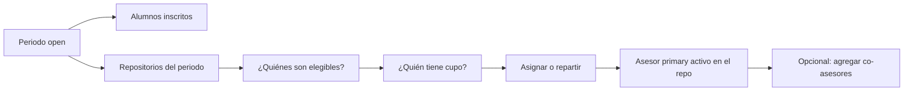
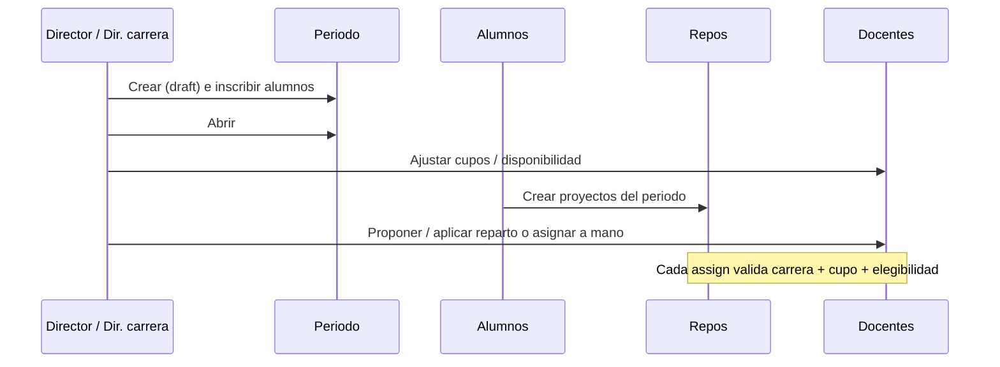

# Flujo: asignación de asesores académicos

Recorrido de punta a punta que cruza periodos, repositorios y docentes.
Detalle de reglas: [06-project-periods.md](../business/06-project-periods.md), [07-academic-advisors.md](../business/07-academic-advisors.md).

Hoy **no** hay un botón del alumno tipo “solicitar asesor y que el sistema asigne uno solo”.
